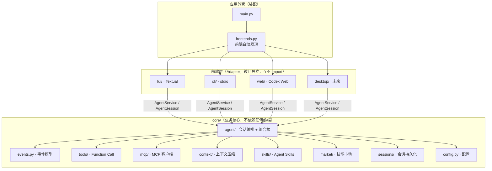

# Zagent

基于 `Practice02/chat-stream-tool-file0ps.py` 改造的**核心逻辑与界面分离**的 Agent 工程，
内置 Textual TUI、命令行 CLI，以及类似 dsh-codex-ui 的 Codex 风格 Web 前端。

- 流式输出、多轮循环、会话历史（与原版一致）
- Function Call 工具组：Mermaid 架构图 `.mmd` 文件操作（create / update / list / read）
  + 本地日期时间查询（getLocalDateTime）
  + 联网搜索（searchWeb，百度千帆百度搜索 API）
  + 网页正文抓取（fetchWeb，本地 curl + trafilatura 转 Markdown）
  + 本地命令行执行（RunCli）+ 通用文件操作（file0ps）
  + 按需加载技能（loadSkill）+ 创建技能（createSKill）
  + 历史归档检索（recallContext）
- Agent Skills 动态加载：初始化只注册 `.agents/skills` 中各技能的
  name / description，完整说明由 `loadSkill` 工具按需读取
- 本地技能市场：`F2` / `/market` 浏览、搜索、安装、卸载 `market/`
  中的技能包，安装后实时刷新技能清单与 System Prompt
- Codex 风格 Web 前端（`--ui web`）：工作区会话树、全局搜索、
  轮次导航、置顶 / 归档 / 分叉、输入历史、深浅色主题；会话持久化到
  `.zagent/sessions/`
- 上下文压缩：`/compact` 归档原始历史 + LLM 摘要替换；80% 阈值监控与输入拦截；
  `recallContext` 检索归档原文；状态栏常驻显示上下文占用
- **斜杠命令补全面板**：输入 `/` 自动弹出命令引导，`↑/↓` 选择、`Enter` 补全；
  `/new` `/save` `/resume` `/export` 等会话管理命令（恢复面板上下键选择）
- **配置驱动**：工具超时 / 截断长度 / MCP 超时等参数全部来自 `config.ini`
  （缺省时使用内置默认值）；首次运行自动生成带 mock 信息的完整配置并弹窗提示
- **`AGENTS.md` 项目规范**：会话首次加载时注入一次并持久化，全程复用（利于缓存）
- **MCP 后台异步加载**：先进入 TUI 界面，连接完成后再自动刷新侧栏的
  “MCP Server + 可用工具”区域，不阻塞启动
- `core`（业务核心）与前端完全解耦，前端只消费 core 的事件流
- TUI 界面：横幅 / 消息块 / 可展开工具卡片（含耗时）/ 右侧信息栏 / 状态栏 / 帮助弹窗

## 目录结构

```
Zagent/
├── main.py               # 入口：装配 core + 选择前端（唯一进程级装配点）
├── frontends.py          # 应用外壳：前端自动发现（新增前端零改动）
├── .mcp.json             # MCP Server 连接配置（在“当前项目目录”读取，可选）
├── config.ini            # 运行配置（[llm]/[agent]/[search]/[web]/[tools]/[mcp]）
├── config.example.ini    # 配置模板（含 [tools] / [mcp] 参数说明）
├── requirements.txt
├── examples/             # 示例（stdio MCP Server，供 .mcp.json 拉起自测）
│   └── mcp_demo_server.py
├── tools_mcp_test.py     # MCP 集成自测（18 项断言，不调用 LLM）
├── llm_mcp_e2e.py        # 端到端自测（真实 LLM 通过 Function Call 调 MCP）
├── context_test.py       # 上下文压缩 / 监控 / 检索自测（73 项断言，不调 LLM）
├── tui_context_test.py   # TUI 上下文显示与输入拦截冒烟（headless，13 项）
├── agent_extras_test.py  # 命令 / 配置化 / AGENTS.md / 保存恢复 / MCP 异步（73 项）
├── tui_extras_test.py    # TUI 命令补全 / 恢复面板 / 首次运行弹窗（headless，29 项）
├── compact_e2e.py        # 端到端自测（真实 LLM 走完整 /compact + recallContext）
├── market/               # 本地技能市场源目录（可直接放入技能包）
│   └── README.md         #   市场包格式与使用说明
│
├── core/                 # ① 业务核心层（不依赖任何界面技术）
│   ├── config.py         #   配置：环境变量 > config.ini > 默认值 + 首次运行生成
│   ├── errors.py         #   统一异常体系（带 category 供界面分类展示）
│   ├── events.py         #   事件模型：界面渲染的唯一输入
│   ├── ports.py          #   前端端口接口 Frontend（六边形架构的 Port）
│   ├── commands.py       #   会话控制命令语义与命令目录（14 条 + 补全匹配）
│   ├── llm/              #   LLM 接入层：OpenAI 兼容流式客户端
│   │   ├── client.py     #     ChatClient / ChatStream（SSE 解析，yield TextDelta）
│   │   └── types.py      #     消息、ToolCall、StreamResult 等数据模型
│   ├── context/          #   上下文管理：Token 估算监控 / 归档 / 压缩 Prompt
│   │   ├── tokens.py     #     estimate_tokens + ContextMonitor（80% 阈值）
│   │   ├── archive.py    #     .agents/context/*.jsonl 归档写入与关键词检索
│   │   ├── compaction.py #     压缩专用 Prompt、历史序列化、摘要构造
│   │   └── __init__.py
│   ├── mcp/              #   MCP 客户端层（.mcp.json → 连接 / 工具发现 / 转发）
│   │   ├── config.py     #     .mcp.json 解析（stdio 与 streamable_http 两种传输）
│   │   ├── client.py     #     单 Server 连接（SDK 标准接口 + 结果格式化）
│   │   ├── manager.py    #     常驻任务调度 / 工具注册 / 名字映射 / 故障隔离
│   │   └── __init__.py   #     对外 API：MCPManager / load_mcp_config
│   ├── tools/            #   工具层：Function Call 定义 / 注册 / 分发 / 实现
│   │   ├── base.py       #     ToolSpec + ToolRegistry（schema 与执行一处维护）
│   │   ├── mermaid.py    #     4 个 Mermaid 文件工具 + 语法校验
│   │   ├── datetime_tools.py  # 本地日期时间工具 getLocalDateTime
│   │   ├── web_search.py #     联网搜索工具 searchWeb（百度千帆 API）
│   │   ├── fetch_web.py  #     网页正文抓取工具 fetchWeb（curl + trafilatura）
│   │   ├── run_cli.py    #     本地命令行执行工具 RunCli
│   │   ├── file_tools.py #     通用文件操作工具 file0ps（读写 / 建目录 / 列目录）
│   │   ├── skill_tools.py     # 加载与创建 skill：loadSkill / createSKill
│   │   └── context_tools.py   # 历史检索工具 recallContext（全文关键词）
│   ├── skills/           #   Agent Skills 层
│   │   ├── catalog.py    #     .agents/skills 扫描 + Frontmatter 元信息解析
│   │   └── __init__.py
│   ├── market/           #   本地技能市场
│   │   ├── service.py    #     扫描 / 搜索 / 安装 / 卸载技能包
│   │   └── __init__.py
│   ├── sessions/         #   会话持久化（Web 前端的会话树数据源）
│   │   ├── store.py      #     .zagent/sessions/*.json 读写 / 搜索 / 分叉
│   │   └── export.py     #     /export：消息历史 → Markdown
│   └── agent/            #   编排层
│       ├── service.py    #     AgentService：组合根（装配客户端与工具 / MCP 异步加载）
│       ├── session.py    #     AgentSession：ask() 问答事件 + compact() 上下文压缩
│       ├── agents_md.py  #     AGENTS.md 一次注入、全程复用
│       └── prompts.py    #     System Prompt
│
├── tui/                  # ② Textual 终端前端（当前默认）
│   ├── __init__.py       #   导出 Frontend = TUIFrontend
│   ├── app.py            #   ZagentApp：横幅/对话区/工具卡片/侧栏/状态栏 + 命令补全
│   ├── widgets.py        #   ChatBlock 消息块 + ToolCard 可展开工具卡片
│   ├── help.py           #   HelpScreen 帮助弹窗（命令表来自 core/commands）
│   ├── market.py         #   MarketScreen 本地技能市场弹窗
│   ├── resume.py         #   ResumeScreen 历史会话面板（↑/↓ + Enter + Esc）
│   ├── startup.py        #   StartupScreen 首次运行配置提示弹窗
│   └── render.py         #   展示辅助（截断 / 压缩），展示策略归界面所有
│
├── cli/                  # ③ 命令行前端（无第三方依赖的参考实现 / 回退）
│   ├── __init__.py       #   导出 Frontend = CLIFrontend
│   ├── app.py
│   ├── market.py         #   交互式市场（list/search/info/install/uninstall）
│   └── render.py
│
├── web/                  # ④ Codex 风格 Web 前端（标准库 HTTP，无 Node 构建）
│   ├── __init__.py       #   导出 Frontend = WebFrontend
│   ├── frontend.py       #   启动本地 HTTP 服务 / 自动打开浏览器
│   ├── server.py         #   REST API + 事件轮询 + 会话树 + 搜索
│   └── static.py         #   内嵌单页界面（HTML / CSS / JS）
│
└── （未来）desktop/  mobile/   ……同类平级前端目录
```

## 分层与依赖方向



依赖规则：

1. 前端只依赖 `core`（`AgentService`、`AgentSession`、事件类型、`Settings`），
   不 import 彼此，也不被 core import；
2. `core` 只依赖标准库与 `requests` / `mcp` 等第三方库，不打印、不读界面；
3. 新增前端 = 新增一个含 `__init__.py` 且导出 `Frontend` 的平级目录，
   `frontends.py` 自动发现，`main.py` 与 core 均无需改动。

## 事件驱动（core 是前端的唯一契约）

UI 调用 `session.ask(question)` 拿到一个**事件生成器**，逐个消费并渲染。
core 不做任何打印 / 渲染，也不把异常抛给界面：

| 事件 | 含义 |
| --- | --- |
| `TextDelta` | 流式文本增量（逐字到达） |
| `AssistantText` | 某一轮 assistant 完整文本（增量已全部到达） |
| `ToolCallStart` | 模型发起一次工具调用（含原始 JSON 参数） |
| `ToolCallEnd` | 该工具执行完毕（结果文本 + 是否成功） |
| `LimitReached` | 工具调用轮次达到上限 |
| `ContextUsage` | 上下文占用快照（每次 LLM 响应后发出，首次越 80% 带 warning） |
| `CompactStart` / `CompactProgress` / `CompactEnd` | `/compact` 压缩过程 |
| `TurnError` | 本次提问失败（网络 / 接口 / 上下文已满等，不抛异常） |
| `TurnEnd` | 本次提问结束（无论成败都会发出） |

工具执行结果统一以文本回填给模型；`错误：…` 前缀会被会话层识别为失败，
模型可据此自我纠正。TUI 用后台线程消费事件并通过 `call_from_thread` 回投
UI 线程，因此流式输出不会阻塞界面。

## 运行

```bash
pip install -r requirements.txt        # textual 为可选依赖，缺失时自动回退 cli

python main.py                         # auto：tui 优先，缺失回退 cli
python main.py --ui tui                # Textual 终端界面
python main.py --ui cli                # 传统命令行界面
python main.py --ui web                # Codex 风格 Web 界面（自动打开浏览器）
python main.py --ui web --web-port 9000 --no-web-browser
python main.py --list-ui               # 列出全部可用/不可用前端
python main.py --config cfg.ini --model deepseek-chat --diagram-dir ./out
python main.py --market-dir ./market          # 指定本地技能市场目录
```

TUI 界面（主界面）：

- 顶部横幅：`Zagent · N 个工具 · 模型`、工作目录、快捷键提示；
- 对话区：左侧色条消息块（你=橙 / Zagent=蓝），流式逐字渲染；
- 工具卡片：绿条 `▶ √ name(args) · 耗时`，点击展开「参数 / 结果」（失败为红条 ✗）;
- 右侧信息栏（`Ctrl+B` 开关）：会话记录 id、模型、接口、目录、MCP 连接数、
  AGENTS.md 状态、轮次、消息、上限、状态；下方为
  **技能清单 / 工具清单 / MCP Server 与各自可用工具**；
- 底部输入框 + 状态栏（`● 状态 · N 轮 │ 模型 │ 工具 N 次 │ 耗时 │ 上下文 12.3k/128.0k(默认) · 9.6% │ Esc 中断`）+ Footer；
- 输入 `/` 自动弹出**命令补全面板**：`↑/↓` 选择、`Enter` 补全；输入完整命令
  （如 `/help`）时 `Enter` 直接执行；`Ctrl+P` 也可唤出补全面板。

TUI 命令（`/help` 或 `F1` 打开帮助弹窗）：

| 命令 | 作用 |
| --- | --- |
| `/help` | 打开帮助弹窗（使用方式 / 命令表 / 快捷键表） |
| `/clear` | 清空界面（保留历史） |
| `/new` | 新建会话（自动保存当前会话历史） |
| `/save [标题]` | 保存当前会话到 `.zagent/sessions/`，之后每轮自动写回 |
| `/resume` | 历史会话面板：`↑/↓` 选择、`Enter` 恢复、`Esc` 取消 |
| `/export [目录]` | 导出会话为 Markdown（默认 `.zagent/exports/`） |
| `/compact` | 压缩上下文：归档原始历史 → LLM 生成约 5k token 摘要 → 替换上下文 |
| `/tools` | 列出已注册工具 |
| `/mcp` | 查看 MCP Server 连接状态与可用工具 |
| `/market [搜索词]` | 打开本地技能市场（如 `/market pdf`） |
| `/cwd` | 显示工作目录 |
| `/model` | 显示模型与接口 |
| `/config` | 显示当前生效配置（密钥脱敏） |
| `/quit` | 退出（别名 `exit` / `quit` / `q`） |

TUI 快捷键：`Enter` 发送 / 补全命令 · `↑/↓` 命令面板切换 · `Esc` 中断生成 ·
`F1` 帮助 · `F2` 技能市场 · `Ctrl+Q` 退出 · `Ctrl+L` 清屏（保留历史）·
`Ctrl+N` 新会话（自动保存）· `Ctrl+S` 保存 · `Ctrl+R` 恢复 · `Ctrl+B` 侧栏开关 ·
`Ctrl+P` 命令面板。
以上命令同时由 CLI 前端支持（语义共享 `core/commands.py`；CLI 的 `/resume`
用序号选择）。

## 配置

优先级：**环境变量 > config.ini > 内置默认值**

```ini
[llm]
base_url  = https://api.deepseek.com
api_key    = sk-xxxx            # 或环境变量 OPENAI_API_KEY
model_name = deepseek-chat      # 或环境变量 CHAT_MODEL

[agent]
temperature     = 0.7
timeout         = 60
max_tool_rounds = 8             # 单次提问的工具调用最大轮次
diagram_dir     =               # 留空 = <当前工作目录>/diagrams
market_dir      =               # 留空 = <当前工作目录>/market
context_window  = 0             # 模型上下文窗口（token）；0 = 未知 → 默认 128k 并标注“默认”

[search]
baidu_qianfan_api_key = bce-v3/xxxx  # 或环境变量 BAIDU_QIANFAN_API_KEY
timeout               = 20           # 搜索请求超时（秒）
default_top_k         = 10           # 模型未指定 top_k 时默认返回条数（1..50）
max_snippet_chars     = 600          # 单条搜索摘要最大字符数

[web]
host         = 127.0.0.1   # 或环境变量 ZAGENT_WEB_HOST
port         = 8787        # 或环境变量 ZAGENT_WEB_PORT
open_browser = 1           # 启动后自动打开浏览器（1/0），或 ZAGENT_WEB_OPEN_BROWSER

[tools]                    # 工具行为参数（缺省 / 留空时使用内置默认值）
fetch_timeout      = 30        # fetchWeb 下载超时（秒）
fetch_max_bytes    = 8388608   # fetchWeb 单页 HTML 上限（字节，默认 8MB）
fetch_max_chars    = 20000     # fetchWeb 返回正文上限（字符）
file_read_chars    = 8000      # file0ps 单次读取上限（字符）
file_list_entries  = 500       # file0ps list 最多展示条目数
cli_timeout        = 60        # RunCli 默认执行超时（秒）
cli_max_timeout    = 600       # RunCli 允许的最大超时（秒）
cli_max_chars      = 8000      # RunCli 输出截断长度（字符）
recall_limit       = 5         # recallContext 返回条数
recall_max_chars   = 3000      # recallContext 结果长度上限（字符）

[mcp]                      # MCP 客户端参数
connect_timeout = 20       # 单个 Server 连接超时（秒）
call_timeout    = 60       # MCP 工具调用超时（秒）
```

### 首次运行：自动生成 config.ini

当前目录没有 `config.ini` 且未指定 `--config` / `ZAGENT_CONFIG` 时，
启动会自动生成一份**完整的、带 mock 信息**的 `config.ini`（所有配置段齐全，
`api_key`、搜索 Key 等标注为模拟值），并：

- TUI：弹出提示对话框，可「退出（推荐）」或「仍然继续」；
- CLI：在控制台提示，按 `Enter` 继续、输入 `q` 退出；
- Web 等其它前端：在启动控制台打印提示。

修改真实配置后重新启动即可（第二次启动不再提示）。

### 参数归零：代码里不再硬编码

工具超时 / 截断长度 / 返回条数 / MCP 超时等都通过 `Settings` 注入到
`build_default_registry(...)` 与 `MCPManager(...)`，代码中只保留**默认值**作为兜底
（`core/config.py` 的 `DEFAULT_TOOLS` / `DEFAULT_MCP` / `DEFAULT_SEARCH`，与
`config.example.ini` 保持一致）。

### 联网搜索（searchWeb）

`searchWeb` 通过百度千帆「百度搜索」API
（`POST https://qianfan.baidubce.com/v2/ai_search/web_search`）获取实时
网页信息，接收 `query`（必填）与 `top_k`（可选，1..50，默认取
`[search] default_top_k`），把每条结果的摘要（最长 `max_snippet_chars` 字符）、
来源标题、URL 与日期整理后回传给模型。API Key 从 `config.ini` 的 `[search]`
段读取，不硬编码；`baidu_qianfan_apikey` 作为兼容键名同样可用。

当未配置 Key、网络超时/不可达、HTTP 非 200、API 返回错误码或结果为空时，
工具会把清晰的错误/空结果说明作为工具调用结果返回给模型，不会中断会话。
API Key 可在[百度智能云 API Key 页面](https://console.bce.baidu.com/iam/#/iam/apikey/list)
创建。

### 网页正文抓取（fetchWeb）

`fetchWeb` 接收一个网页 `url`，通过本地 `curl` 下载 HTML，再用
`trafilatura` 识别正文并转换为 Markdown，保留标题、段落、列表、表格与
链接，去除导航栏、广告、页脚等无关内容；最终把 Markdown 正文和原始
URL 返回给模型。实现细节：

- 使用 `subprocess.run([...], shell=False)` 参数列表调用 curl，避免命令注入；
- curl 启用重定向、压缩、超时、最大文件体积和 http/https 协议限制；
- 自动识别 UTF-8 / GBK / Big5 等页面编码；
- 正文超过 `[tools] fetch_max_chars`（默认 20000）字符时按段落截断，控制上下文 token；
  HTML 下载上限由 `fetch_max_bytes`（默认 8MB）、超时由 `fetch_timeout` 控制；
- 处理 URL 非法、网络失败、超时、HTTP 错误、HTML 解析失败和正文无法提取等情况，
  以工具结果形式返回清晰错误。

需要本地存在 `curl` 可执行文件，并安装 `trafilatura`
（`pip install -r requirements.txt`）。

### RunCli / file0ps

- `RunCli`：以参数列表（`shell=False`）执行本机命令，返回 stdout / stderr /
  退出码；默认超时 `cli_timeout`、上限 `cli_max_timeout`、输出截断 `cli_max_chars`，
  全部来自 `config.ini`；
- `file0ps`：读写 / 追加 / 建目录 / 列目录，所有路径限制在项目根目录内；
  读取上限 `file_read_chars`、列目录条数 `file_list_entries` 可配置。

## MCP（接入外部工具服务器）

Zagent 内置 MCP（Model Context Protocol）客户端，可连接任意 MCP Server，
把它们提供的工具**动态并入同一个工具注册表**，与 `RunCli` / `fetchWeb` /
`loadSkill` 等本地工具共存，统一走 Agent 的 Function Calling 流程。

依赖：`pip install mcp`（已列入 `requirements.txt`；没有 `.mcp.json` 时
不安装也能正常运行）。

### 1. 配置：`.mcp.json`

启动时在**当前项目目录**（程序启动时的工作目录，而非 Zagent 源码目录）
读取 `.mcp.json`：

```json
{
  "mcpServers": {
    "Bazi-MCP": {
      "type": "streamable_http",
      "url": "https://mcp.api-inference.modelscope.net/56737d90bf474d/mcp"
    },
    "local-demo": {
      "command": "python",
      "args": ["examples/mcp_demo_server.py"],
      "env": { "API_TOKEN": "..." },
      "cwd": "D:/my-project"
    },
    "PetHospital": {
      "type": "stdio",
      "command": "python",
      "args": ["E:/LLM/PetHospitalMCP/pet-hospital-mcp-stdio/server.py"],
      "env": { "PET_API_BASE_URL": "http://127.0.0.1:8080" }
    }
  }
}
```

`PetHospital` 是一个现成示例：把宠物医院 REST API 封装成 12 个业务工具
（档案增删改查、病历、收费、费用汇总、经营统计），详见
`E:\LLM\PetHospitalMCP\pet-hospital-mcp-stdio\README.md`。

| 字段 | 适用 | 说明 |
| --- | --- | --- |
| `type` | 两者 | `stdio` / `streamable_http`（可写 `streamable-http`、`http` 等别名）；省略时：有 `url` 视为 streamable_http，有 `command` 视为 stdio |
| `command` `args` `env` `cwd` | stdio | 拉起子进程的可执行文件、参数、附加环境变量、工作目录 |
| `url` `headers` | streamable_http | 服务端地址与额外请求头（`Authorization` 等） |
| `timeout` | 两者 | 单次工具调用超时（秒），默认取 `[mcp] call_timeout` |

配置缺失不是错误（等同于不启用 MCP）；配置非法、Server 连不上时只输出
一条明确的错误信息（CLI 打到 stderr、TUI 显示在侧栏 **MCP 区域**、Web 显示在
关于面板），**不影响其它 Server 与本地工具**。

### 2. 工具发现与注册

连接成功后客户端调用 `list_tools()` 拿到每个工具的名称、描述与参数
Schema（自动兼容分页与 SDK 1.x / 2.x 差异），包装成 `ToolSpec` 注册进
`ToolRegistry`：

- 描述末尾追加 `（来自 MCP 服务器 <name>）`，便于模型判断来源；
- 为避免多 Server / 与本地工具重名，内部维护
  **「暴露给 LLM 的工具名 → (Server, 原始工具名)」映射**：优先用原名，
  冲突时自动加服务器名前缀（如 `Bazi-MCP_getBaziDetail`），转发时还原。

### 3. 工具调用

模型发起 Function Call 后，`MCPManager` 按映射定位 Server，把工具名与参数
转发给 `call_tool()`，并把结果统一整理成回传模型的文本：

- **文本内容**：逐块拼接（图片 / 音频只保留摘要，避免 base64 撑爆上下文）；
- **结构化数据**：`structuredContent` 序列化为带缩进的 JSON（与文本重复时跳过）；
- **错误信息**：`isError` 与协议错误统一转成 `错误：MCP 工具 xxx …`，
  会被会话层标记为失败，模型可据此自我纠正；
- 超时、连接中断等异常同样转成错误文本，不会让会话崩溃。

### 4. 运行模型与故障隔离

- 每个 Server 对应一个**常驻任务**，跑在独立的事件循环线程中；同步的
  `ToolHandler` 通过 `run_coroutine_threadsafe` 提交调用，因此与 TUI /
  Web 的事件循环互不干扰（也规避了 MCP SDK 的 anyio cancel scope
  “跨任务退出”问题）；
- 连接、握手、`list_tools` 任一步失败只记一条 `ok=false` 状态，其它
  Server 与本地工具照常可用；
- 进程退出时 `AgentService.shutdown()` 会关闭全部连接并回收 stdio 子进程
  （另有 `atexit` 兜底）。

### 5. 异步加载与 TUI 侧栏

- TUI 启动时使用 `AgentService(..., mcp_async=True)`：MCP 连接放到后台线程，
  **界面立即进入**，侧栏先显示「MCP Server · 加载中…」；
- 连接完成后 UI 线程被唤醒：横幅工具数、右侧栏 MCP 区域、状态栏与 `/mcp`
  同步刷新，并在对话区提示 `MCP 加载完成：N/M 个 Server 已连接…`；
- 侧栏按 Server 分组展示：`✓ 名称 · N 个工具`、传输方式与目标地址，
  以及该 Server 提供的**每个工具名**；失败的 Server 显示 `✗` 与错误原因；
- 连接 / 调用超时来自 `config.ini` 的 `[mcp] connect_timeout` / `call_timeout`
  （单个 Server 也可在 `.mcp.json` 里用 `timeout` 覆盖调用超时）；
- CLI / Web 保持同步连接（启动横幅即为最终状态）。

### 6. 自测

```powershell
python tools_mcp_test.py   # 18 项断言：配置解析 / 注册 / 转发 / 错误隔离 / stdio
python llm_mcp_e2e.py      # 真实 LLM 通过 Function Calling 调用 Bazi-MCP
python llm_mcp_e2e.py "帮我新建一只宠物档案：……"   # 调用 PetHospital 工具
python agent_extras_test.py  # 异步加载：mcp_async + wait_mcp
```

`tools_mcp_test.py` 会临时拉起 `examples/mcp_demo_server.py`（stdio 传输）
并构造一个不可达的 HTTP Server，验证“坏 Server 报错、好 Server 与本地工具
不受影响”；当 `.mcp.json` 同时配置多个 Server（如 Bazi + PetHospital）时，
也会验证多 Server 共存与工具并存注册。

## 上下文压缩与历史检索（/compact + recallContext）

有限上下文窗口下的长任务支持：**手动压缩 + 本地归档 + 全文检索**，
全部为纯标准库实现（不使用向量库 / Embedding / 检索框架）。

### 1. 上下文长度监控与输入拦截

- **用量来源**：优先采用模型 API 报告的 `usage.prompt_tokens`
  （请求自动带 `stream_options.include_usage`，该值精确包含 System Prompt +
  对话历史 + 工具定义与工具消息；服务不支持该字段时会自动降级去掉重试）；
  拿不到时按“中日韩字符 1 token/字、其余 4 字符/token”本地估算
  （`core/context/tokens.py` 的 `estimate_tokens`）。
- **汇报时机**：每次 LLM 完成响应后发出 `ContextUsage` 事件，
  `AgentSession.context_usage` 也可供界面随时刷新。
- **80% 阈值**：达到窗口的 80% 时——首次越界发出 `warning=True` 的警告，
  同时会话进入 `blocked` 状态，**暂停接受普通用户提示词**（`ask()` 直接返回
  `TurnError`，不追加消息），直到 `/compact` 压缩成功为止；
  压缩进行中（`compacting=True`）同样拒绝新的提问。
- **窗口大小**：`[agent] context_window`（或环境变量 `ZAGENT_CONTEXT_WINDOW`）
  配置；为 0 / 留空表示无法获知，按默认 **128k** 处理，界面显示
  `128.0k(默认)`。

### 2. TUI 显示（醒目位置）

- **状态栏常驻**：`│ 上下文 12.3k/128.0k(默认) · 9.6%`，
  <60% 绿色、60~80% 黄色、≥80% 红色并追加 `⚠需/compact`；
- **右侧信息栏**（`Ctrl+B`）同步显示占用比例，越阈值时给出
  “已达 80%，请输入 /compact”提示；
- 首次越界还会弹出 Textual 通知，CLI 则把警告打到 stderr。

### 3. `/compact` 压缩流程

```
/compact
  → CompactStart（进入压缩状态：拒绝普通提问与工具执行）
  → 归档：完整原始上下文写入 .agents/context/<编号>.jsonl
      （保留角色 / 内容 / 工具调用参数 / 工具返回结果 / 消息顺序，
        写完回读校验行数；归档失败则中止，历史保持原样）
  → CompactProgress（阶段提示）
  → 调用 LLM 生成约 5,000 token 的 Markdown 工作摘要
      （请求不携带任何工具 schema，因此压缩期间无法 Function Calling）
  → 用摘要替换历史：只保留 System Prompt + 一条含摘要的 assistant 消息
      （存在 AGENTS.md 时额外保留规范消息），
      摘要末尾追加归档说明（时间、归档编号、recallContext 提示）
  → CompactEnd（解除输入限制；压缩失败则原上下文不变，可重新 /compact）
```

- 归档编号形如 `20261022-153000.jsonl`（同秒重复时追加序号防覆盖）；
- 摘要超过约 10k token 时按段落边界截断并注明（防止摘要本身撑爆上下文）；
- 压缩 Prompt 集中在 `core/context/compaction.py` 的 `COMPACT_PROMPT`。

### 4. `recallContext` 工具

普通 Function Calling 工具，用于找回压缩摘要里丢失的历史细节：

| 参数 | 说明 |
| --- | --- |
| `text` | **必填**关键词，空格分隔多个词，命中越多排名越靠前 |
| `id` | 可选归档编号（如 `20261022-153000`），省略时检索全部归档 |

- 纯本地全文匹配：按行读取 `.agents/context/*.jsonl`，对消息整行做
  关键词计分，返回**归档编号 + 消息位置 + 角色 + 原始内容片段**
  （围绕首个命中词截取；条数与总长度由 `[tools] recall_limit` /
  `recall_max_chars` 控制，默认 5 条、3000 字符）；
- 归档不存在 / 关键词为空会返回 `错误：…` 文本，模型可据此自我纠正；
- 与压缩形成闭环：`/compact` 归档 → 摘要 → 缺细节 → `recallContext` 找原文。

### 5. 自测

```powershell
python context_test.py       # 73 项断言（不调用 LLM）：监控阈值 / 归档 / 压缩 /
                             #   失败回滚与重试 / recallContext 检索
python tui_context_test.py   # TUI headless 冒烟（13 项）：状态栏 k/k·% 显示、
                             #   “默认”标注、80% 拦截、/compact 路由
python compact_e2e.py        # 真实 LLM 端到端：产生历史 → /compact → 摘要 →
                             #   recallContext 检索归档原文
```

## 会话管理（/save · /resume · /export · /new）

- 会话以 `<工作目录>/.zagent/sessions/<id>.json` 保存（与 Web 前端同一套
  `SessionStore`），目录整体已被 `.gitignore` 忽略；
- `/save [标题]`：把当前历史写入记录（首次新建、之后更新同一条），并**绑定**
  持久化 —— 之后每轮问答结束自动写回；
- `/resume`：TUI 打开历史会话面板（`↑/↓` 选择、`Enter` 恢复、`Esc` 取消），
  CLI 打印编号列表后输入序号恢复；恢复时重建历史并重绘对话区；
- `/new`：新建会话前会**自动保存**当前会话（没有对话内容则跳过）；
- `/export [目录]`：导出 Markdown（默认
  `.zagent/exports/session-<id>-<时间>.md`），含用户 / Zagent / 工具调用与工具结果；
- `/mcp` `/config`：查看 MCP 连接与当前生效配置（密钥脱敏）。

自测：

```powershell
python agent_extras_test.py   # 73 项：命令解析 / 配置段 / 首次运行生成 /
                              #   工具参数注入 / AGENTS.md / 保存恢复 / MCP 异步
python tui_extras_test.py     # 29 项（headless）：命令补全面板 / 首次运行弹窗 /
                              #   /save → /new 自动保存 → /resume 恢复 / 侧栏 MCP 区
```

## AGENTS.md 项目规范（一次注入，全程复用）

在**当前项目目录**放置 `AGENTS.md`（可选），Zagent 会在会话首次加载时：

1. 读取该文件内容；
2. 包装成**一条消息**（`role=user`，固定标记 `[项目规范 AGENTS.md]`）插入到
   System Prompt 之后、第一条用户消息之前；
3. 随历史一起持久化到会话日志（`.zagent/sessions/*.json`），后续轮次
   **直接复用、不再重复注入** —— 前缀保持稳定，利于模型侧缓存命中；
4. `/compact` 压缩后仍会保留这条消息（摘要替换历史但不丢项目规范）。

设计说明：

- 用 `user` 角色而不是追加 `system`：OpenAI 兼容服务普遍只接受第一条
  system 消息，且会话存储层只保留 user/assistant/tool 角色；
- 会话恢复（`/resume`、Web 打开旧会话）时，历史里已有该消息就跳过；
  旧会话没有则补一次；
- 文件不存在 / 内容为空白时不注入，也不产生任何副作用。

## Agent Skills（动态加载）

Zagent 启动时会以**程序启动时的工作目录**作为项目根目录，扫描
`.agents/skills/` 下的各个 skill 子目录。每个子目录至少包含一个
`skill.md`（也兼容 `SKILL.md`），文件开头必须是 YAML Frontmatter，
并声明 `name` 与 `description`：

```text
<项目根目录>/
└── .agents/
    └── skills/
        └── pdf-processing/
            ├── skill.md
            └── references/
                └── api.md
```

```markdown
---
name: pdf-processing
description: 从 PDF 中提取文本与表格，并生成结构化结果
---

# PDF 处理

具体操作步骤……
需要接口细节时读取 `references/api.md`。
```

- **初始化只读元信息**：只解析 Frontmatter 中的 `name` / `description`，
  不读取正文，因此不会提前占用上下文；
- **System Prompt 注入**：可用技能以
  `- 'name': description` 列表加入 System Prompt，并提示模型按需调用
  `loadSkill`；
- **`loadSkill` 工具**：
  - `name`（必填）：skill 名称（也支持大小写不敏感匹配与目录名别名）；
  - `filename`（可选）：附加文件路径。省略时返回 `skill.md` 全文；
    提供时只读取该文件，不会重复附带 `skill.md`；
  - `filename` 支持 skill 目录相对路径、项目相对路径与绝对路径；
  - 精确路径不存在时，会在该 skill 目录内递归查找；唯一匹配直接读取，
    多个同名文件则返回候选相对路径，由模型选择下一次读取哪个；
  - 所有读取都限制在指定 skill 目录内部，拒绝 `..`、绝对路径越界及
    指向目录外的文件，避免读取项目中的其它文件。
- **`createSKill` 工具**（用户要求创建 skill 时由模型调用）：
  - `name`（必填）：skill 名称，自动规范化为小写字母、数字与连字符
    （例如 `PDF Processing` -> `pdf-processing`）；
  - `skillContext`（必填）：写入 `SKILL.md` 的完整内容，推荐包含正文与
    YAML Frontmatter；
  - 在 `.agents/skills/<name>/` 下生成 `SKILL.md`，并自动校验 / 补齐
    Frontmatter 的 `name` 与 `description`，确保符合 Agent Skills 规范；
  - 同名 skill（已有 `SKILL.md`）已存在时返回明确提示，**绝不覆盖**原有内容；
    若目录已存在但还没有 `SKILL.md`（例如已提前放入 exe、参考资料），
    会在该目录中补写 `SKILL.md`，不改动其它文件；
  - `references/`、`scripts/` 等辅助目录 / 文件由模型继续调用
    `file0ps` 创建。
- **动态加载**：skill 正文与附加文件只有在模型真正调用 `loadSkill`
  后才进入对话上下文；原有 RunCli、Mermaid、`file0ps` 等工具流程保持不变。

缺少 Frontmatter、缺少 `name` / `description`、名称重复或缺少
`skill.md` 的 skill 会被跳过并记录警告，不会阻止 Agent 启动。

## 本地技能市场（Market）

Zagent 内置一个类似 dsh-market 的本地技能市场：从 `market/` 读取技能包，
安装到 `.agents/skills/`，安装 / 卸载后立即刷新当前会话的技能清单与
System Prompt。

```text
<项目根目录>/
├── market/                     # 市场源目录（可配置 market_dir）
│   └── pdf-tools/
│       ├── skill.md            # 标准 Agent Skill
│       └── references/api.md
└── .agents/skills/             # 安装目标
    └── pdf-tools/
```

市场包使用与普通 Skill 相同的 Frontmatter，另外支持可选的展示字段：

```markdown
---
name: pdf-tools
description: 从 PDF 中提取文本与表格
version: 1.0.0
author: your-name
category: 文档
tags: [pdf, extract]
homepage: https://example.com
---
```

使用方式：

- TUI：`F2` 或 `/market` 打开市场弹窗，支持搜索、查看详情、安装、
  重新安装、卸载与刷新；
- CLI：`/market` 进入交互式市场，也支持一次性命令：

```text
/market list
/market search pdf
/market info pdf-tools
/market install pdf-tools
/market install pdf-tools --force
/market uninstall pdf-tools
```

安全约束：

- 市场包名称会作为安装目录名，拒绝路径分隔符、`..`、系统保留名等；
- 安装目标必须位于 `.agents/skills/`，卸载同样拒绝目录外路径；
- 已安装时默认拒绝覆盖，必须显式 `--force` / 弹窗确认重新安装；
- `.agents/skills/` 中已有、但不在市场源目录中的技能会以“本地已安装”
  形式展示，可查看详情和卸载，但不能通过市场重新安装；
- 市场为空时，界面会给出 `market/<name>/skill.md` 的放入指引。

## Codex 风格 Web 前端

`python main.py --ui web` 会在本地启动一个无第三方依赖的 HTTP 服务
（默认 `http://127.0.0.1:8787/`）并打开浏览器。界面参考 dsh-codex-ui，
聚焦“在工作区里组织、检索和回访长对话”：

- **Codex 风格侧栏**：置顶会话与工作区会话分组，运行中 / 未读状态点；
- **工作区会话树**：新建、重命名、置顶、标记未读、复制、归档、分叉、删除；
- **全局搜索**：同时搜索标题与消息正文，命中后跳转到对应轮次；
- **轮次导航**：对话左侧的轮次标记，点击滚动并高亮该轮用户消息；
- **流式消息与工具卡片**：Markdown、代码块、可展开的工具参数 / 结果；
- **输入历史**：按工作区保存在 localStorage，`↑` / `↓` 召回；
- **深浅色主题、侧栏折叠**：偏好保存在浏览器本地；
- **设置 / 关于**：模型、接口、工作区、工具与技能列表、市场目录。

会话持久化在 `<工作区>/.zagent/sessions/*.json`，刷新页面或重启服务后
仍可继续；TUI / CLI 默认仍是纯内存会话，但可用 `/save` 写入同一套存储、
`/resume` 恢复（详见“会话管理”一节）。

Web 界面快捷键：`Enter` 发送 · `Shift+Enter` 换行 · `↑`/`↓` 历史输入 ·
`Ctrl+K` 新建任务 · `Esc` 关闭菜单 / 搜索 / 弹窗。

> 服务默认只监听 `127.0.0.1`，没有登录鉴权；如需修改监听地址，请自行确认
> 网络环境可信，不要直接暴露到公网。

## 如何新增一个前端（desktop / mobile）

1. 在根目录新建包，例如 `desktop/`（`desktop/__init__.py`、`desktop/app.py`…）；
2. 实现 `core.ports.Frontend`，并在 `desktop/__init__.py` 中导出
   `Frontend = DesktopFrontend`；
3. 内部消费 `AgentService` 与 `session.ask()` 事件流，渲染方式自定。

`frontends.py` 会自动发现新目录，**无需修改 core、main.py 或任何既有前端**；
缺少可选依赖时该前端自动标记为不可用，不影响其他前端。
